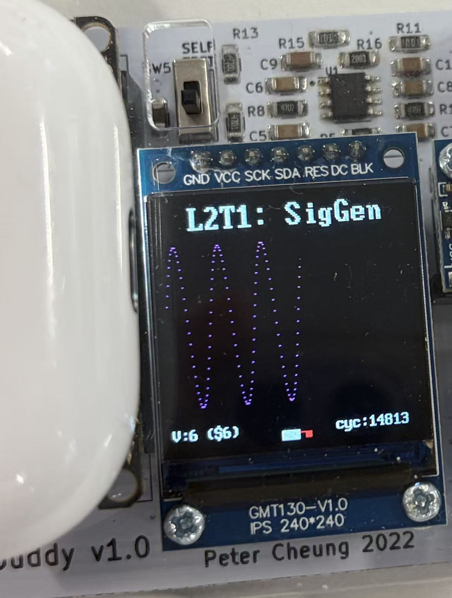
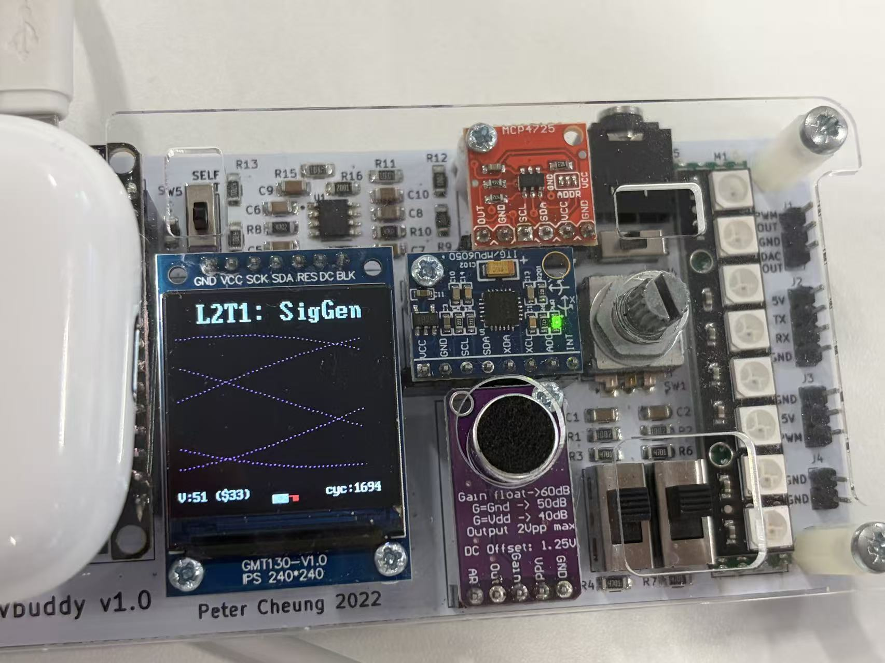

# Lab 2 — Sinegen

- Built `sinegen.sv` by connecting a counter to a ROM.
- Loaded the ROM with 256 sinusoidal samples from `sinerom.mem`.
- Used the counter output as the ROM address to read the samples repeatedly.
- Used the Vbuddy rotary encoder to change the address increment and control the waveform frequency.

- Simulated the design with Verilator and displayed the generated waveform on Vbuddy using `vbdPlot()`.
