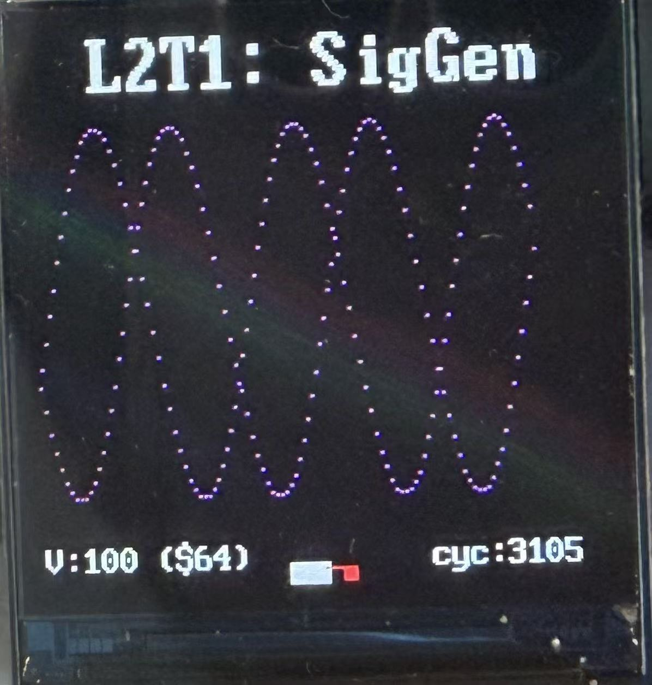

# Lab 2 — Sinegen
### Task 1
- Built `sinegen.sv` by connecting a counter to a ROM.
- Loaded the ROM with 256 sinusoidal samples from `sinerom.mem`.
- Used the counter output as the ROM address to read the samples repeatedly.
- Used the Vbuddy rotary encoder to change the address increment and control the waveform frequency.

- Simulated the design with Verilator and displayed the generated waveform on Vbuddy using `vbdPlot()`.


### Task 2

- Modified the ROM to read two samples simultaneously from the same waveform table.
- Used the counter address for `data1` and added a rotary-encoder offset for `data2`.
- Kept the counter increment fixed at 6, so both outputs have the same frequency.
- Used `vbdValue()` to control the phase offset and called `vbdPlot()` twice to display both outputs.
- Observed two sinusoidal traces with different phases on Vbuddy.
- An offset of 64 samples corresponds to a 90° phase difference in the 256-sample table.

| Signal | Direction | Function |
| --- | --- | --- |
| `clk` | Input, 1 bit | Clock for the counter and ROM |
| `rst` | Input, 1 bit | Reset the counter |
| `en` | Input, 1 bit | Enable the counter |
| `incr[7:0]` | Input, 8 bits | Rotary-encoder phase offset in this task |
| `data1[7:0]` | Output, 8 bits | Sample at the counter address |
| `data2[7:0]` | Output, 8 bits | Sample at the counter address plus offset |

```text
clk, rst, en
     │
     ▼
 Counter (+6) ── address ──┬──────────► ROM read 1 ──► data1
                          │
incr (phase offset) ──► [ + ] ───────► ROM read 2 ──► data2
                          address + offset
```

Both ROM reads use the same clock and the same stored samples. In this implementation, the port named `incr` controls phase offset; the counter step is fixed internally.
